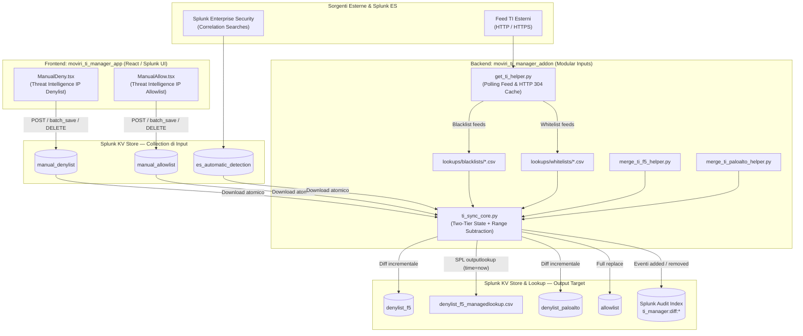
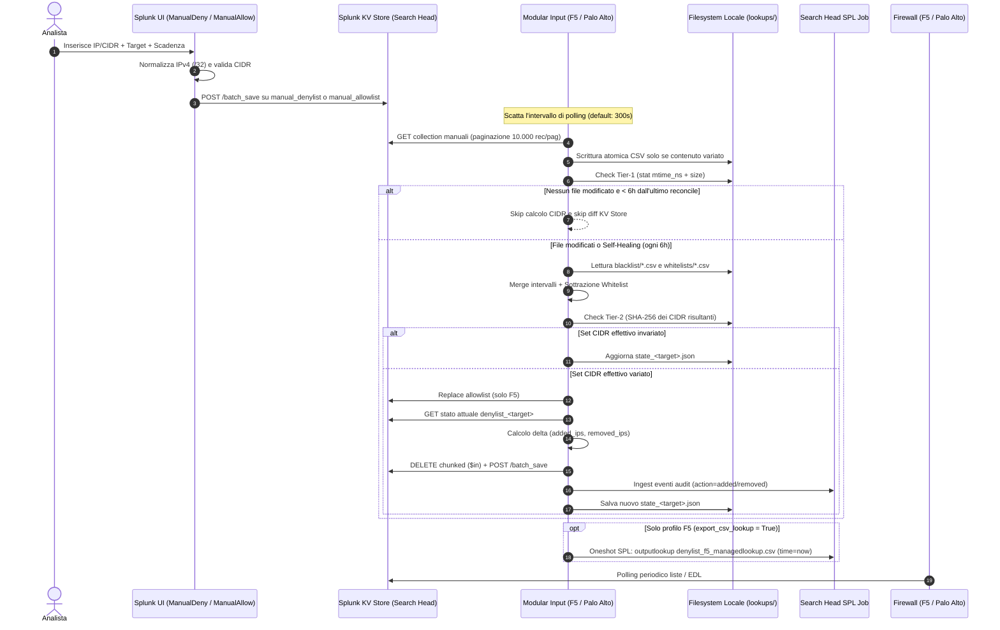

# Moviri Threat Intelligence (TI) Manager

Piattaforma Splunk composta da una **Data App Frontend (`moviri_ti_manager_app`)** e da un **Technical Add-on Backend (`moviri_ti_manager_addon`)** per l'acquisizione, l'aggregazione CIDR, la gestione manuale e la sincronizzazione differenziale di liste IP/Subnet verso apparati **F5** e **Palo Alto Networks**.

---

## Indice

1. [Architettura del Sistema](#1-architettura-del-sistema)
2. [Modello Dati e Collection KV Store](#2-modello-dati-e-collection-kv-store)
3. [Manuale Operativo: Blocco e Sblocco Manuale](#3-manuale-operativo-blocco-e-sblocco-manuale)
   - [Blocco Manuale (IP Denylist)](#31-blocco-manuale-ip-denylist)
   - [Sblocco Manuale / Whitelisting (IP Allowlist)](#32-sblocco-manuale--whitelisting-ip-allowlist)
   - [Caricamento Massivo da File (Bulk Upload)](#33-caricamento-massivo-da-file-bulk-upload)
   - [Revoca, Ricerca e Rimozione Liste](#34-revoca-ricerca-e-rimozione-liste)
   - [Gestione delle Scadenze (Expiration)](#35-gestione-delle-scadenze-expiration)
4. [Ciclo di Vita End-to-End di un IP](#4-ciclo-di-vita-end-to-end-di-un-ip)
5. [Logiche di Precedenza, Matematica CIDR e Perimetro Target](#5-logiche-di-precedenza-matematica-cidr-e-perimetro-target)
6. [Motore di Sincronizzazione e Ottimizzazioni](#6-motore-di-sincronizzazione-e-ottimizzazioni)
7. [Build, Packaging e Manutenzione](#7-build-packaging-e-manutenzione)
8. [Audit, Monitoraggio e Troubleshooting](#8-audit-monitoraggio-e-troubleshooting)

---

## 1. Architettura del Sistema

L'ecosistema è suddiviso in due componenti Splunk disaccoppiati che comunicano tramite il **KV Store** del Search Head:



### Componenti principali

| Componente                  | Percorso                                      | Ruolo                                                                                                               |
| :-------------------------- | :-------------------------------------------- | :------------------------------------------------------------------------------------------------------------------ |
| **Manual Deny UI**          | `ManualDeny.tsx`                              | Interfaccia React per blocco manuale singoli IP/CIDR, bulk upload, target selection e rimozione.                    |
| **Manual Allow UI**         | `ManualAllow.tsx`                             | Interfaccia React per sblocco manuale / eccezioni in whitelist globale e bulk upload.                               |
| **Feed Collector**          | `package/bin/get_ti_helper.py`                | Scarica feed TI esterni in streaming con caching HTTP (`ETag`/`Last-Modified`) e scrive CSV atomici.                |
| **Sync Core Engine**        | `package/bin/ti_sync_core.py`                 | Libreria condivisa per caching a 2 livelli, algebra degli intervalli IPv4/IPv6, sync KV Store e audit.              |
| **F5 Merge Input**          | `package/bin/merge_ti_f5_helper.py`           | Modular input schedulabile per la sincronizzazione di `denylist_f5`, `allowlist` e `denylist_f5_managedlookup.csv`. |
| **Palo Alto Merge Input**   | `package/bin/merge_ti_paloalto_helper.py`     | Modular input schedulabile per la sincronizzazione di `denylist_paloalto`.                                          |
| **Custom REST Handler**     | `package/bin/ti_manager_custom_handler_rh.py` | Rimuove automaticamente i CSV locali associati quando una stanza `get_ti` viene eliminata dalla UI.                 |
| **Configurazione Centrale** | `package/bin/configs.py`                      | Costanti globali, nomi collection, timeout, chunk size e `STATIC_PRIVATE_NETWORKS`.                                 |

---

## 2. Modello Dati e Collection KV Store

Tutte le collection risiedono nel namespace `servicesNS/nobody/moviri_ti_manager_app/storage/collections/data/<collection>`.

### Collection di Input (Gestite da Operatori / Splunk ES)

#### `manual_denylist`

| Campo        | Tipo     | Esempio                    | Descrizione                                                                                        |
| :----------- | :------- | :------------------------- | :------------------------------------------------------------------------------------------------- |
| `_key`       | `string` | `203.0.113.45_32`          | Chiave primaria KV Store generata dalla UI sostituendo `/` con `_` (`cidr.replace(/\//g, '_')`).   |
| `ip`         | `string` | `203.0.113.45/32`          | Indirizzo IPv4 o subnet CIDR normalizzata.                                                         |
| `target`     | `string` | `Both (F5+PaloAlto)`       | Destinazione del blocco: `"Both (F5+PaloAlto)"` oppure `"F5"`.                                     |
| `user`       | `string` | `admin`                    | Utente Splunk autenticato (rilevato da `/services/authentication/current-context`).                |
| `reason`     | `string` | `INC-4921 Brute force`     | Motivazione operativa (default `"No reason provided"` o `"Bulk upload"`).                          |
| `timestamp`  | `string` | `2026-11-18T14:00:00.000Z` | Data/ora UTC di inserimento in formato ISO-8601.                                                   |
| `expirydate` | `string` | `2026-11-19T14:00:00.000Z` | Data/ora UTC di scadenza ISO-8601; stringa vuota `""` per blocco permanente (`Never`).             |
| `source`     | `string` | `ioc_campaign.csv`         | Presente **solo** per record caricati via _Bulk Upload_ (mostrato come `Manual Entry` se assente). |

#### `manual_allowlist`

Ha lo **stesso identico schema** di `manual_denylist`, ad eccezione del campo `target` (non presente perché lo sblocco in whitelist si applica sempre globalmente sia a F5 che a Palo Alto).

#### `es_automatic_detection`

Popolata dalle Detection di Splunk Enterprise Security; contiene il campo `ip` utilizzato come sorgente automatica di blocco.

### Collection e Lookup di Output (Generati dal Backend)

| Risorsa                         | Tipo       | Schema                          | Consumatore                       |
| :------------------------------ | :--------- | :------------------------------ | :-------------------------------- |
| `denylist_f5`                   | KV Store   | `_key` (`md5(ip)`), `ip` (CIDR) | F5 BIG-IP / Splunk                |
| `denylist_f5_managedlookup.csv` | CSV Lookup | `ip`, `time` (epoch `now()`)    | F5 / Consumer lookup esterni      |
| `denylist_paloalto`             | KV Store   | `_key` (`md5(ip)`), `ip` (CIDR) | Palo Alto Networks EDL / MineMeld |
| `allowlist`                     | KV Store   | `_key` (`md5(ip)`), `ip` (CIDR) | F5 BIG-IP / Palo Alto Networks    |

---

## 3. Manuale Operativo: Blocco e Sblocco Manuale

### 3.1 Blocco Manuale (IP Denylist)

Aprire la vista **Threat Intelligence IP Denylist** nella Data App `moviri_ti_manager_app`.

#### Procedura passo-passo (Inserimento rapido fino a 20 IP)

1. **IPs:** inserire uno o più indirizzi IPv4 o subnet CIDR separati da virgola, punto e virgola o spazio (es. `198.51.100.12, 203.0.113.0/24`).
   - Gli indirizzi IPv4 privi di prefisso vengono normalizzati automaticamente in `/32`.
   - Il form blocca l'invio se sono inseriti **più di 20 IP**, se il formato CIDR IPv4 non è valido (`0.0.0.0/0` – `255.255.255.255/32`) o se almeno un IP è **già presente** in tabella.
2. **Reason (Optional):** inserire il riferimento al ticket/incidente o la motivazione del blocco.
3. **Target:** selezionare l'ambito di applicazione del blocco:
   - `Both (F5+PaloAlto)` _(default)_: blocca l'IP su **entrambi** i firewall (F5 e Palo Alto).
   - `F5`: blocca l'IP **esclusivamente su F5**.
4. **Expiration:** impostare la durata del blocco (`Minutes`, `Hours`, `Days`) oppure selezionare `Never` per un blocco permanente.
5. Cliccare su **Add IP(s)**. Il record viene salvato immediatamente nel KV Store `manual_denylist` e propagato ai firewall alla successiva esecuzione dei modular input.

---

### 3.2 Sblocco Manuale / Whitelisting (IP Allowlist)

Prima di agire per sbloccare un IP, verificare l'origine del blocco:

| Origine del blocco                                                                                                        | Azione corretta da eseguire                                                                                                                                          |
| :------------------------------------------------------------------------------------------------------------------------ | :------------------------------------------------------------------------------------------------------------------------------------------------------------------- |
| L'IP è stato inserito per errore in **Manual Denylist**                                                                   | Eliminare il record direttamente dalla tabella **All Denied IPs** in _Manual Denylist_.                                                                              |
| L'IP proviene da un **Feed TI esterno** o da **Splunk ES** (`es_automatic_detection`)                                     | Inserire l'IP in **Manual Allowlist**. Eliminarlo dalla denylist manuale non avrebbe effetto perché il feed continuerebbe a riproporlo.                              |
| L'IP appartiene a una **subnet CIDR ampia** bloccata da un feed (es. un singolo host legittimo dentro una `/24` malevola) | Inserire il singolo IP (`/32`) o la sotto-rete (`/29`, `/28`, ecc.) in **Manual Allowlist**. Il backend scorporerà automaticamente quell'intervallo dalla blacklist. |

#### Procedura passo-passo (Inserimento in Allowlist)

1. Aprire la vista **Threat Intelligence IP Allowlist**.
2. Nel pannello **Add to Allowlist**, inserire fino a **20 IP/CIDR** separati da virgola, spazio o punto e virgola.
3. Compilare **Reason (Optional)** (consigliato indicare il motivo dell'eccezione).
4. Impostare **Duration** (`Minutes`, `Hours`, `Days` o `Never`).
5. Cliccare su **Add IP(s)**. Non è richiesto alcun selettore _Target_: ogni voce in `manual_allowlist` ha validità globale su **F5 e Palo Alto**.

---

### 3.3 Caricamento Massivo da File (Bulk Upload)

Sia **Denylist** che **Allowlist** supportano l'importazione massiva tramite il pulsante **Bulk Upload** (formati ammessi: `.txt`, `.csv`).

#### Formato del file

- **Non inserire righe di intestazione** (es. niente `ip,user,reason` nella prima riga), poiché ogni riga non vuota viene validata come indirizzo IP/CIDR.
- Struttura per riga: `IP[,User[,Reason]]`

```csv
198.51.100.10,m.rossi,Campagna Phishing Q4
203.0.113.0/24,m.rossi,Infrastruttura C2 confermata
192.0.2.55
```

#### Regole di elaborazione del Bulk Upload

- **Valori di fallback:** se `User` è omesso nella riga, viene usato l'utente Splunk loggato; se `Reason` è omesso, viene usato il valore scritto nel campo _Reason_ del form oppure `"Bulk upload"`.
- **Target e Scadenza:** vengono ereditati dai menu a tendina _Target_ (solo Denylist) e _Duration/Expiration_ selezionati nel form al momento del caricamento.
- **Tracciamento sorgente:** tutti i record importati ricevono nel campo `source` il nome del file caricato, permettendo la successiva cancellazione in blocco dell'intera lista.
- **Validazione atomica:** se **anche una sola riga** del file contiene un formato IP/CIDR non valido, l'intero caricamento viene annullato prima di inviare dati al KV Store, segnalando il numero di errori e il primo valore errato.
- **Deduplica automatica:** eventuali IP già presenti nella collection o duplicati all'interno del file vengono ignorati senza generare errori. I nuovi record vengono inviati al KV Store in batch da **1.000 elementi** (`/batch_save`).

---

### 3.4 Revoca, Ricerca e Rimozione Liste

In entrambe le interfacce l'operatore dispone di tre strumenti di gestione:

1. **Ricerca e Ordinamento:** la barra di ricerca (con debounce a 300 ms) filtra istantaneamente su `IP`, `Target`, `Source`, `User` e `Reason`. Le intestazioni di colonna supportano l'ordinamento numerico reale per gli indirizzi IP (`ipToNumber`) e cronologico per `Timestamp` ed `Expiry Date`.
2. **Eliminazione selettiva (`Delete Selected`):** selezionando una o più righe tramite checkbox (o il checkbox di intestazione per selezionare l'intera pagina corrente) compare il pulsante **Delete Selected (N)**. Previa conferma modale, i record vengono eliminati dal KV Store in chunk da **100 chiavi** (`DELETE ?query={"_key":{"$in":[...]}}`).
3. **Eliminazione per file sorgente (`Uploaded Lists Management`):** se sono presenti liste caricate tramite _Bulk Upload_, sopra la tabella principale appare un riepilogo raggruppato per nome file (`File Name`, `Subnets Count`, `Uploaded By`, `Date`) con il pulsante **Remove Entire List** per revocare con un solo clic tutti gli IP associati a quel caricamento.

---

### 3.5 Gestione delle Scadenze (Expiration)

Nella colonna **Expiry Date**, la UI evidenzia lo stato temporale di ogni record con codifica visiva:

- **Verde (`Never`):** regola permanente senza scadenza.
- **Testo standard:** regola attiva con scadenza superiore alle 24 ore.
- **Rosso (`#ff4c4c`):** regola in scadenza entro le prossime **24 ore** (`<= 86.400.000 ms`).
- **Grigio barrato (`Expired (...)`, opacità 60%):** regola la cui `expirydate` è nel passato.

> **Nota Operativa Importante — Cleanup dei record scaduti:**
> Attualmente, i record con `expirydate <= now` vengono esclusi dal calcolo delle KPI card in alto (`Total Active Denies` / `Total Active Allows`) e mostrati barrati in tabella, **ma non vengono rimossi automaticamente dal KV Store** né filtrati dal motore Python durante il sync.
> Finché un record scaduto resta nella collection `manual_denylist` o `manual_allowlist`, **continua a essere applicato sui firewall**. Per renderne effettiva la rimozione è necessario eliminarlo dalla UI (oppure configurare una Saved Search Splunk periodica che esegua `| inputlookup manual_denylist | where isnull(expirydate) OR expirydate=="" OR strptime(expirydate, "%Y-%m-%dT%H:%M:%S.%3NZ") > now() | outputlookup manual_denylist` e analogamente per `manual_allowlist`).

---

## 4. Ciclo di Vita End-to-End di un IP

Il diagramma seguente illustra la sequenza completa dal momento in cui l'analista inserisce un blocco o uno sblocco fino all'aggiornamento sui firewall:



### Fasi del ciclo di vita

1. **Acquisizione (`T0`):** l'operatore salva il record tramite UI (o Splunk ES inserisce un rilevamento automatico). Il record è immediatamente presente nel KV Store sorgente (`manual_denylist` / `manual_allowlist`).
2. **Download e Split per Target (`T1` — al ciclo del modular input):**
   - `ti_sync_core.py` scarica `manual_denylist` e smista i record in due file locali:
     - `lookups/blacklists/manual_denylist_f5_paloalto.csv` (record con `target == "Both (F5+PaloAlto)"`).
     - `lookups/blacklists/manual_denylist_f5.csv` (record con `target == "F5"`).
   - Scarica `manual_allowlist` in `lookups/whitelists/manual_allowlist.csv`.
   - Se il contenuto estratto è identico al CSV già su disco, `atomic_write_if_changed` non riscrive il file, preservando il timestamp `mtime_ns` del sistema operativo.
3. **Calcolo delle Reti Effettive (`T2`):**
   - Tutte le whitelist locali, la `manual_allowlist` e le reti private protette (`STATIC_PRIVATE_NETWORKS`) vengono fuse in intervalli numerici continui.
   - Tutte le blacklist applicabili al target vengono fuse e **sottratte** dagli intervalli di whitelist (`_subtract_ranges`).
4. **Propagazione Differenziale & Audit (`T3`):**
   - Il motore confronta il nuovo set CIDR con il contenuto reale della collection remota (`denylist_f5` o `denylist_paloalto`).
   - Applica **solo le differenze** (`added_ips` e `removed_ips`) e scrive un evento di audit per ciascun IP aggiunto o rimosso nell'indice configurato.
5. **Aggiornamento Timestamp Lookup F5 (`T4`):**
   - Per il target F5 (`export_csv_lookup=True`), al termine di ogni ciclo viene eseguita la query SPL `| inputlookup denylist_f5 | eval time=now() | table ip time | outputlookup denylist_f5_managedlookup.csv` per aggiornare il campo `time` anche quando non vi sono state variazioni sugli IP.

---

## 5. Logiche di Precedenza, Matematica CIDR e Perimetro Target

### Regola di Precedenza ("Whitelist Wins")

La whitelist ha **sempre precedenza assoluta** su qualsiasi blacklist (manuale, feed esterni o Splunk ES).
Quando un IP o una sotto-rete in allowlist ricade all'interno di un blocco CIDR più ampio in blacklist, il motore `_subtract_ranges` **frammenta automaticamente la subnet bloccata** nelle sotto-reti CIDR minime complementari.

**Esempio pratico di sblocco puntuale:**

- Blacklist (da feed esterno): `198.51.100.0/24` (256 IP)
- Sblocco manuale in `ManualAllow`: `198.51.100.10/32`
- Risultato calcolato e inviato ai firewall (`denylist_f5` / `denylist_paloalto`):
  `198.51.100.0/29`, `198.51.100.8/31`, `198.51.100.11/32`, `198.51.100.12/30`, `198.51.100.16/28`, `198.51.100.32/27`, `198.51.100.64/26`, `198.51.100.128/25` (tutti i 255 IP tranne `.10`).

### Reti Private Protette di Default (`STATIC_PRIVATE_NETWORKS`)

In `configs.py` sono definite le seguenti reti che vengono **sempre** aggiunte automaticamente alla whitelist di sistema per impedire blocchi accidentali dell'infrastruttura interna:

- `10.0.0.0/8` (RFC 1918)
- `172.16.0.0/12` (RFC 1918)
- `192.168.0.0/16` (RFC 1918)
- `127.0.0.0/8` (Loopback)
- `169.254.0.0/16` (Link-Local)
- `100.64.0.0/10` (Carrier-Grade NAT / RFC 6598)

### Confronto tra Profili Target (`F5` vs `Palo Alto`)

| Caratteristica                         | Profilo `F5` (`merge_ti_f5`)                                                                                                         | Profilo `Palo Alto` (`merge_ti_paloalto`)                                  |
| :------------------------------------- | :----------------------------------------------------------------------------------------------------------------------------------- | :------------------------------------------------------------------------- |
| **File di stato locale**               | `lookups/master/state_f5.json`                                                                                                       | `lookups/master/state_paloalto.json`                                       |
| **Collection Denylist Target**         | `denylist_f5`                                                                                                                        | `denylist_paloalto`                                                        |
| **Sorgenti Blacklist incluse**         | **Tutti** i CSV in `lookups/blacklists/*.csv` (Feed esterni `get_ti` + `manual_denylist_f5_paloalto.csv` + `manual_denylist_f5.csv`) | **Solo** `manual_denylist_f5_paloalto.csv` ed `es_automatic_detection.csv` |
| **Sorgenti Whitelist incluse**         | **Tutti** i CSV in `lookups/whitelists/*.csv` + `STATIC_PRIVATE_NETWORKS`                                                            | **Tutti** i CSV in `lookups/whitelists/*.csv` + `STATIC_PRIVATE_NETWORKS`  |
| **Sincronizza collection `allowlist`** | Sì (`sync_allowlist=True`)                                                                                                           | No (`sync_allowlist=False`)                                                |
| **Export SPL `*_managedlookup.csv`**   | Sì, ad ogni ciclo (`export_csv_lookup=True`)                                                                                         | No (`export_csv_lookup=False`)                                             |
| **Sourcetype Audit**                   | `ti_manager:diff:f5`                                                                                                                 | `ti_manager:diff:paloalto`                                                 |

---

## 6. Motore di Sincronizzazione e Ottimizzazioni

### Caching a Doppio Livello (`state_<target>.json`)

Per minimizzare il carico CPU/I/O sul nodo di esecuzione e sulle API REST della Search Head, `ti_sync_core.py` adotta due livelli di controllo:

1. **Tier-1 — Metadati Filesystem (`st_mtime_ns` + `st_size`):**
   Prima di aprire qualsiasi CSV, verifica timestamp nanosecondo e dimensione dei file tracciati. Se coincidono con `files_meta` salvato in `state_<target>.json`, il ciclo termina in **< 0.1s** senza aprire alcun file.
2. **Tier-2 — Hash SHA-256 dei CIDR Effettivi (`effective_bl_hash` / `effective_wl_hash`):**
   Se un file CSV è cambiato, calcola i CIDR finali aggregati. Se l'impronta SHA-256 del risultato è identica alla precedente (es. un feed ha aggiunto un IP già coperto da una `/16` o neutralizzato dalla whitelist), aggiorna solo i metadati locali e **salta completamente** le chiamate al KV Store.
3. **Self-Healing Periodico (ogni 6 ore):**
   Ogni `21.600` secondi (`SELF_HEALING_INTERVAL_SECONDS`), il motore ignora la cache Tier-1/Tier-2 e forza un controllo completo contro il KV Store remoto per riallineare eventuali modifiche manuali o drift.

### Prestazioni e Resilienza

- **Fast-Path IPv4 C-level:** gli indirizzi IPv4 singoli vengono convertiti in interi a 32 bit tramite `socket.inet_pton` + `struct.unpack` (~20x più rapido rispetto a `ipaddress.ip_network`).
- **HTTP Conditional Requests (`get_ti_helper.py`):** memorizza `ETag` e `Last-Modified` in file sidecar `.nome_input.meta.json` e invia `If-None-Match` / `If-Modified-Since` per sfruttare risposte `304 Not Modified`.
- **Scritture Atomiche:** tutti i CSV e i file di stato vengono scritti tramite file temporanei (`tempfile.mkstemp`) + `fsync` + `os.replace`, prevenendo letture parziali anche in caso di esecuzioni concorrenti tra i modular input.
- **Paginazione e Batching Controllati:** letture KV Store da `10.000` record/pagina con proiezione pura `fields=ip` (o `ip,target`), timeout disaccoppiati `(connect=10s, read=90s)` e backoff esponenziale sui `ReadTimeout`.

---

## 7. Build, Packaging e Manutenzione

Il repository include lo script `project_manager.sh` per automatizzare ambiente virtuale Python (`3.9.20`), build UCC dell'add-on e build Yarn della Data App:

```bash
# 1. Creazione virtualenv e installazione dipendenze di sviluppo
./project_manager.sh venv-all

# 2. Build e packaging del Technical Add-on (moviri_ti_manager_addon)
./project_manager.sh ta-all

# 3. Build e packaging della Data App Frontend (moviri_ti_manager_app)
./project_manager.sh da-all

# Pulizia directory temporanee
./project_manager.sh clean-output
./project_manager.sh clean-deliverables
```

I pacchetti `.tar.gz` / `.spl` pronti per il deploy vengono generati nella directory `deliverables/`.

### Best Practice Operative

- **Schedulazione sfalsata:** configurare intervalli sfalsati tra `merge_ti_f5` e `merge_ti_paloalto` (es. ogni 300s con offset di 30–60 secondi) per evitare picchi simultanei di richieste REST su `splunkd`.
- **Rimozione di un feed `get_ti`:** eliminando un input `get_ti` dalla UI di configurazione dell'add-on, il custom handler `ti_manager_custom_handler_rh.py` rimuove automaticamente il file `<nome_input>.csv` da `lookups/blacklists/` o `lookups/whitelists/`, garantendo che i relativi IP vengano rimossi dai firewall al ciclo di merge successivo.

---

## 8. Audit, Monitoraggio e Troubleshooting

### Eventi di Audit generati

Ogni aggiunta o rimozione effettiva sulle collection target `denylist_f5` e `denylist_paloalto` produce eventi strutturati nell'indice configurato sull'input (sourcetype `ti_manager:diff:f5` o `ti_manager:diff:paloalto`):

```text
2026-11-18T14:30:05.120411+00:00 action="added", ip="203.0.113.45/32", list_name="denylist_f5"
2026-11-18T14:35:05.881204+00:00 action="removed", ip="198.51.100.10/32", list_name="denylist_paloalto"
```

### Query SPL utili per il monitoraggio

**1. Storico dei blocchi e degli sblocchi applicati ai firewall:**

```spl
index=* sourcetype IN ("ti_manager:diff:f5", "ti_manager:diff:paloalto")
| table _time sourcetype list_name action ip
| sort - _time
```

**2. Verifica dello stato dei cicli di sincronizzazione e tempi di esecuzione:**

```spl
index=_internal "[TI MANAGER INFO]" "[SYNC]"
| rex field=_raw "target=(?<target>\w+).*?(?:total_elapsed|elapsed)=(?<elapsed_sec>[\d\.]+)s"
| timechart max(elapsed_sec) by target
```

**3. Ricerca errori o retry verso il KV Store della Search Head:**

```spl
index=_internal ("[TI MANAGER WARNING]" OR "[TI MANAGER ERROR]")
| table _time log_level _raw
| sort - _time
```

**4. Verifica dello stato di un singolo IP nelle collection sorgente e target:**

```spl
| inputlookup manual_denylist | search ip="203.0.113.45*" | eval source_collection="manual_denylist"
| append [| inputlookup manual_allowlist | search ip="203.0.113.45*" | eval source_collection="manual_allowlist"]
| append [| inputlookup denylist_f5 | search ip="203.0.113.45*" | eval source_collection="denylist_f5"]
| append [| inputlookup denylist_paloalto | search ip="203.0.113.45*" | eval source_collection="denylist_paloalto"]
| table source_collection ip target user reason timestamp expirydate
```
